# Labo 14

Zorg dat je de volgende folder structuur volgt:

```
webtechnologie/
├─ labo-01/
│  ├─ oefening-01/
│  │  ├─ index.html
│  │  ├─ images/
│  │  │  ├─ image-1.jpg
│  │  │  └─ image-n.jpg
│  │  ├─ css/
│  │  │   ├─ normalize.css
│  │  │   └─ style.css
│  │  ├─ data/
│  │  │   ├─ datafile-1.json
│  │  │   └─ datafile-2.json
│  │  └─ js/
│  │     └─ script.js
│  ├─ oefening-02/
│  └─ oefening-n/
├─ labo-02/
└─ labo-n/
```

- Gebruik steeds JS modules om globale variabelen te vermijden (`<script type="module" src="./path/to/script.js"></script>`)
- Volg de [Coding Guidelines](https://webtechnologie.programmeren-ap.be/coding-guidelines)


## Oefeningen arrays

### oefening 1: som

#### leerdoelen

* werken met arrays
* lengte van arrays opvragen
* arrays doorlopen met een for-loop

#### functionele analyse

Je programma geeft de som van een rij getallen terug.

#### technische analyse

Je begint met een `array` te maken van de getallen 1, 2, 3, 4, 5 en 6. Je maakt een variabele `som` en kent er de waarde 0 aan toe.

Vervolgens maak je een lus die van 0 tot het aantal getallen in de array itereert. Elke iteratie tel je het huidige getal op bij een variabele som.

De som print je af op in de console.

#### voorbeeldinteractie
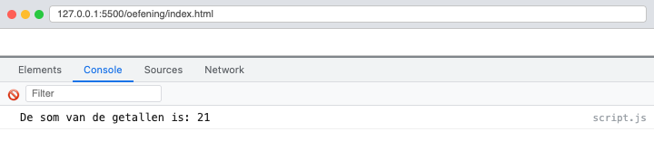

### oefening 2: namen

#### leerdoelen

* werken met arrays
* lengte van arrays opvragen
* arrays doorlopen met een for-loop

#### functionele analyse

Je programma genereert op basis van 2 arrays een lijst van voor- en achternamen.

#### technische analyse

Maak 2 string-arrays aan. De eerste geef je 5 voornamen, de andere 5 achternamen.

Controleer dat de lengte van beide arrays gelijk is. Zo niet print je een foutboodschap.

Gebruik een for-loop om door de lijst van namen te loopen.

Print vervolgens de volledige namen in de console.

#### voorbeeldinteractie

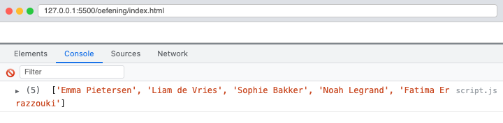

### oefening 3: vrienden

#### leerdoelen

* werken met gebruikersinteractie
* werken met for-loop
* toevoegen van elementen in een array

#### functionele analyse

Je programma vraagt hoeveel vrienden er moeten worden ingevoerd. Op basis daarvan kan je daarna je vrienden toevoegen aan een lijst. Nadien wordt de lijst uitgeprint (laatste ingave eerst).

#### technische analyse

Vraag de gebruiker hoeveel namen er moeten worden ingegeven. Maak hiervoor gebruik van `prompt()`.

Vraag dan X aantal keer de naam van de vriend dat je wenst toe te voegen via `prompt()`.

Voeg de vrienden toe aan een array van vrienden.

Print vervolgens de lijst met vrienden (laatste ingave eerst) in de console.

#### voorbeeldinteractie

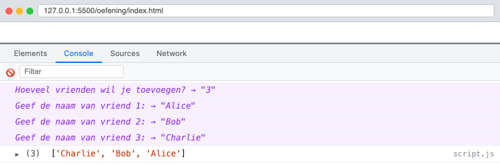

### oefening 4: punten

#### leerdoelen

* werken met for-of-loop
* werken met arrays
* wiskundige bewerkingen
* gebruiken van een do while loop (uitbreiding)

#### functionele analyse

Je programma verwerkt een puntenlijst aan resultaten en print het gemiddelde, het percentage en het aantal gebuisde vakken uit.

#### technische analyse

Gebruik voor deze oefening volgende array:

```
const grades = [16,12,16,7,17,14,9,8,18,12];
```

Gebruik een for-of-loop om door de grades te loopen.

Bereken het gemiddelde, het percentage en het aantal gebuisde vakken.

Print deze waardes in de console.

#### uitbreiding

Breid je programma uit zodat de gebruiker de punten zelf ingeeft in plaats van ze vast in de array te zetten. Vraag met een `do while` lus telkens een punt via `prompt()` en voeg het toe aan de array. Van zodra de gebruiker geen getal meer ingeeft, stopt de lus en print je dezelfde waardes als hierboven. De berekening zelf verandert niet.

#### voorbeeldinteractie

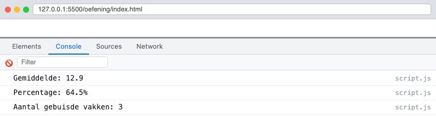

### oefening 5: boodschappenlijst

#### leerdoelen

* een array maken uit een string met `split()`
* elementen toevoegen en verwijderen met `push()`, `unshift()`, `pop()`, `shift()` en `splice()`
* een element vervangen via zijn index
* zoeken in een array met `indexOf()`
* een array afdrukken met `join()`

#### functionele analyse

Je programma beheert een boodschappenlijst. De lijst vertrekt van één string en wordt stap per stap aangepast. Na elke bewerking laat je in de console zien wat er gebeurd is.

#### technische analyse

Je begint met volgende string:

```
const input = "brood,melk,kaas,appels";
```

* Maak met `split()` een array `shoppingList` van deze string. Print hoeveel boodschappen de lijst bevat.
* Voeg `"boter"` achteraan toe met `push()` en `"koffie"` vooraan met `unshift()`. Print de volledige lijst met `join(" | ")`.
* De laatste boodschap valt weg: verwijder die met `pop()`. Deze methode geeft het verwijderde element terug, dus print welke boodschap wegvalt.
* Het eerste element heb je nog in huis: verwijder dat met `shift()` en print welke boodschap dat was.
* Je wil geen kaas maar hummus. Zoek de index van `"kaas"` met `indexOf()` en vervang het element op die index door `"hummus"`. Print op welke index kaas stond.
* Zoek de index van `"chips"`. Die staat niet op je lijst, dus `indexOf()` geeft `-1` terug. Print in dat geval een melding.
* Vraag het element op index 10 op en print het. Die index bestaat niet, dus je krijgt `undefined`.
* Verwijder met `splice()` twee elementen vanaf index 1. Print de verwijderde elementen.
* Print tot slot je definitieve lijst als één regel met `join(", ")`.

#### voorbeeldinteractie

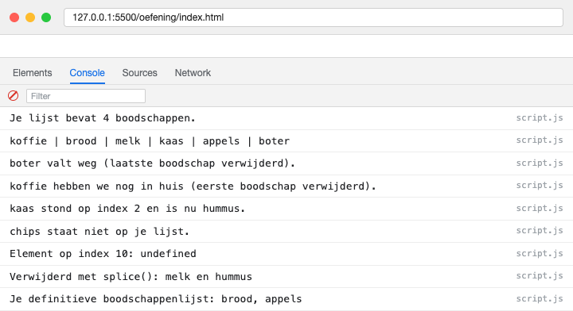

### oefening 6: pokémon team

#### leerdoelen

* gebruiken van loops
* werken met arrays
* zoeken in arrays

#### functionele analyse

Je programma maakt het mogelijk om de gebruiker een team van pokémon samen te stellen.

#### technische analyse

Gegeven is de volgende array van 20 pokemon:

```
let pokemon = [
    "Bulbasaur",
    "Ivysaur",
    "Venusaur",
    "Charmander",
    "Charmeleon",
    "Charizard",
    "Squirtle",
    "Wartortle",
    "Blastoise",
    "Caterpie",
    "Metapod",
    "Butterfree",
    "Weedle",
    "Kakuna",
    "Beedrill",
    "Pidgey",
    "Pidgeotto",
    "Pidgeot",
    "Rattata",
    "Raticate",
    "Spearow",
];
```

* Maak een array `team`. Deze array bevat de pokémon van de gebruiker van het programma.
* Gebruik een lus om de pokémon in een genummerde lijst te printen in de console.

```
1. Bulbasaur
2. Ivysaur
3. Venusaur
4. Charmander
5. Charmeleon
...
```

* Vraag daarna aan de gebruiker welke pokémon er moet toegevoegd worden aan het team. Dit doe je aan de hand van de index van de pokemon. Dit doe je tot de gebruiker STOP ingeeft. Je kan dit doen aan de hand van een `do while` loop.

```
Welke pokemon wil je in je team? [1-21]: 4
Welke pokemon wil je in je team? [1-21]: 3
Welke pokemon wil je in je team? [1-21]: STOP
```

* Als de gebruiker een pokémon ingeeft die al in het team zet dan krijgt hij hiervan een melding en wordt de pokémon niet toegevoegd:

```
Welke pokemon wil je in je team? [1-20]: 4
Welke pokemon wil je in je team? [1-20]: 3
Welke pokemon wil je in je team? [1-20]: 4
Deze pokemon zit al in je team
Welke pokemon wil je in je team? [1-20]: 2
Welke pokemon wil je in je team? [1-20]: STOP
```

* Als de pokémon niet bekend is (dus het ingegeven nummer groter is dan de lengte van de array) wordt er ook een melding gegeven:

```
Welke pokemon wil je in je team? [1-21]: 22
Deze pokemon ken ik niet
Welke pokemon wil je in je team? [1-21]: 4
```

* Als je STOP hebt ingegeven dan wordt het team van de gebruiker in de console getoond:

```
Welke pokemon wil je in je team? [0-20]: 1
Welke pokemon wil je in je team? [0-20]: 2
Welke pokemon wil je in je team? [0-20]: 3
Welke pokemon wil je in je team? [0-20]: 4
Welke pokemon wil je in je team? [0-20]: 5
Welke pokemon wil je in je team? [0-20]: 6
Welke pokemon wil je in je team? [0-20]: STOP
Jouw team van pokemon is: 
1. Ivysaur
2. Venusaur
3. Charmander
4. Charmeleon
5. Charizard
6. Squirtle
```

#### voorbeeldinteractie

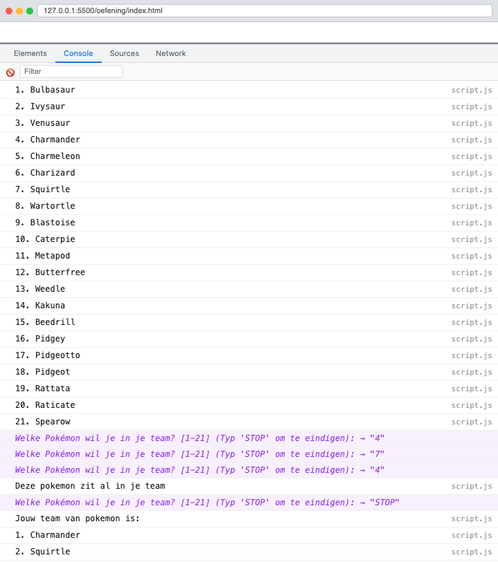

### oefening 7: tweedimensionale som

#### leerdoelen

* twee dimensionale arrays
* geneste lussen

#### functionele analyse

We gaan de som berekenen van alle waarden van een tabel (of tweedimensionale array).

#### technische analyse

We beginnen met de volgende twee dimensionele array:

```
let spreadsheet = [
    [100, 104, 105],
    [144, 110, 109],
    [105, 107, 111]
];
```

* Maak een variabele `sumRow1` en ken de som van de drie elementen van de eerste rij hieraan toe.
* Print de som in de console.
* Doe hetzelfde voor de andere rijen.
* Bereken daarna het totaal van de hele tabel. Gebruik hiervoor een geneste lus: de buitenste lus gaat over de rijen, de binnenste lus over de waarden in die rij.
* Print dit totaal in de console.

#### voorbeeldinteractie

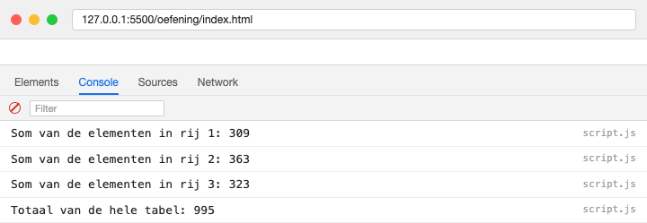

## Oefeningen objecten en JSON

### oefening 8: recept

#### leerdoelen

* objecten aanmaken
* dot notatie gebruiken
* lussen

#### functionele analyse

Het programma berekent de totaalprijs van een gegeven recept.

#### technische analyse

Je maakt een object. Dit bevat een

* naam
* beschrijving
* personen
* ingredienten

de ingredienten bevatten een:

* naam
* hoeveelheid (bv "1 stuk", "1 kg")
* prijs

Maak het object aan met zelfgekozen values en ken deze toe aan aan variabele `spaghetti`.

Print de naam van dit gerecht (via de dot-notatie) gevolgd door de totaalprijs van alle ingredienten in de console.

#### voorbeeldinteractie

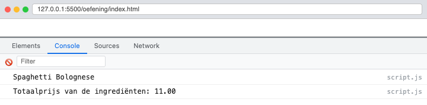

### oefening 9: persoon

#### leerdoelen

* objecten aanmaken
* dot-notatie gebruiken
* gebruik/uitlezen van JSON

#### functionele analyse

Lees een json-bestand in en print daar enkele waardes van op het scherm

#### technische analyse

Maak een **person.json** bestand aan met volgende data:

```
{
  "firstname": "Jurgen",
  "lastname": "Vervoort",
  "age": 27,
  "city": "Heist-op-den-Berg",
  "street": "Bergstraat",
  "number": "17c",
  "postal": 2220,
  "hobbies": ["voetbal", "tafeltennis", "vissen"]
}
```

1. Lees het _person.json_ bestand in
2. Print de volledige naam van de persoon in de console via dot-notatie.
3. Gebruik een for-loop om de hobby's van de persoon één voor één in de console op te lijsten.

#### voorbeeldinteractie

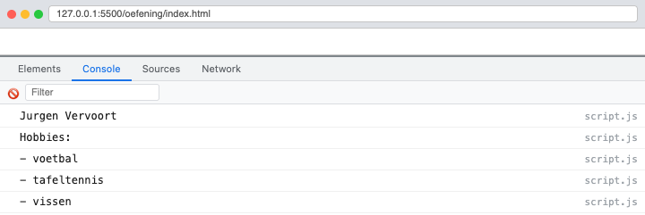

### oefening 10: todo's

#### leerdoelen

* objecten aanmaken
* dot-notatie gebruiken
* gebruik/uitlezen van JSON
* werken met arrays van objecten

#### functionele analyse

Lees todos.json (aanwezig naast deze README file) uit en haal er enkel de reeds voltooide todo's uit.

#### technische analyse

1. Maak een array van Todos door het bestand todos.json uit te lezen.
2. Maak een lege array `completedTodos`.
3. Gebruik een for-loop om door de todos te itereren. Voeg elke voltooide todo toe aan `completedTodos`.
4. Print de titels van de voltooide todo's in de console.

#### voorbeeldinteractie

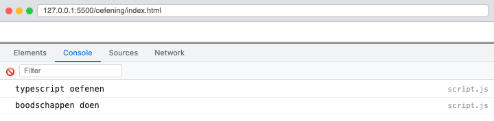

### oefening 11: dieren

#### leerdoelen

* objecten aanmaken
* dot-notatie gebruiken
* gebruik/uitlezen van JSON
* werken met gebruikersinteractie
* werken met arrays van objecten

#### functionele analyse

Toon de gebruiker een lijst van dieren. Nadat de gebruiker een dier kiest wordt wat info betreffende dat gekozen dier weergegeven.

#### technische analyse

Maak een array van dieren `animalData` door het bestand dieren.json in te lezen d.m.v. `import`.

Maak een functie _getAnimalsList()_ dat de `animal[]` als parameter ontvangt en een `string[]` van alle dierennamen teruggeeft.

Print de genummerde lijst van dierennamen in de console.

Gebruik `prompt()` om de gebruiker een dier te laten kiezen op basis van het nummer. Gebruik de arraypositie om de info op te vragen van het gekozen dier en print deze in de console.

#### voorbeeldinteractie

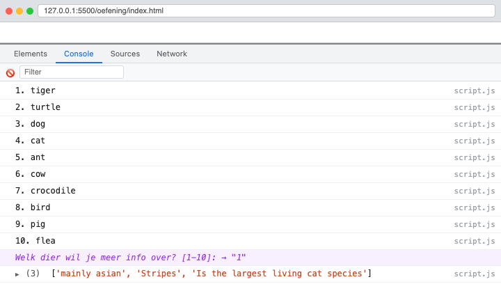
